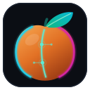

# Apricot Studio

A small video trimmer. Open a file, mark in and out, export the clip.
The export inherits every setting from the source, so there is nothing to configure.

Built for pulling a highlight out of a gpu-screen-recorder replay buffer without
opening kdenlive or DaVinci. Released for Linux as a Flatpak and for Windows as
a zip; it builds and runs on macOS too, though that is not released yet.



## Install

### Linux, as a Flatpak

Download `apricot-studio-<version>.flatpak` from the
[latest release](https://github.com/raulblideran/apricot-studio-rust/releases), then:

```sh
flatpak install --user apricot-studio-1.2.1.flatpak
```

Nothing else needed — the bundle carries its own ffmpeg built with libx264 and
libx265, and the app itself is one binary with no runtime to install.

### Building the Flatpak yourself

```sh
flatpak install --user flathub org.flatpak.Builder \
    org.freedesktop.Sdk//25.08 org.freedesktop.Sdk.Extension.rust-stable//25.08

flatpak run org.flatpak.Builder --user --force-clean --install \
    --repo=repo build-dir packaging/io.github.raulblideran.ApricotStudio.yaml

# The version comes out of Cargo.toml rather than being typed, because a
# bundle named after the release before it is a mistake nobody notices until
# someone reports a bug against the wrong version.
VERSION=$(sed -n '3s/version = "\(.*\)"/\1/p' Cargo.toml)

flatpak build-bundle --runtime-repo=https://flathub.org/repo/flathub.flatpakrepo \
    repo "apricot-studio-$VERSION.flatpak" io.github.raulblideran.ApricotStudio master
```

**`--runtime-repo` is not optional.** Without it the bundle names the runtime it
needs but not where to find it, so it installs for anyone who already has that
runtime and fails for everyone else — easy to miss when testing on a machine that
has it.

The first build compiles x264, x265 and ffmpeg; rebuilds take seconds. The
manifest builds with `--share=network` so cargo can fetch its crates, which is
fine locally and not allowed on Flathub — `packaging/flatpak/generate-cargo-sources.sh`
writes the offline crate list that replaces it.

### Windows

Download `apricot-studio-<version>-windows-x64.zip` from the
[latest release](https://github.com/raulblideran/apricot-studio-rust/releases),
unzip it anywhere, and run `apricot-studio.exe`. ffmpeg and ffprobe are in the
zip beside it. The build is not signed, so SmartScreen asks before the first
run: "More info", then "Run anyway".

### macOS

The code builds and its tests pass — CI compiles it on `macos-latest` on every
push — but it is not packaged or released yet, so there is no `.app` to
download.

### Building on Windows or macOS

From a checkout, `cargo build --release` produces a working binary on either.
The app looks for `ffmpeg` and `ffprobe` beside its own executable before
falling back to `PATH`, so put them in the same folder or install them
(`winget install Gyan.FFmpeg`, `brew install ffmpeg`). With neither, the app
still starts and says exactly what is missing.

### Straight from the source tree (Linux)

```sh
./install.sh              # --uninstall to remove
```

Everything lands under `~/.local`, using the system ffmpeg. **Do not run both
installs at once** — they share a desktop ID, so the flatpak wins in the app menu
while `apricot-studio` in a terminal runs the one you built.

## Why the Flatpak is GPL

The freedesktop runtime's ffmpeg omits libx264 and libx265 because they are GPL,
and H.264 is what screen recorders produce. The manifest builds x264, x265 and
ffmpeg from source, making the bundle **GPL-3.0-or-later**. The alternative,
`h264_vaapi`, is measurably worse at the same bitrate.

Five build details, each of which cost a build to find:

- x265 sets CMake policies `CMP0025` and `CMP0054` to `OLD`, which CMake 4 refuses.
  The manifest patches them to `NEW`.
- SVT-AV1 3.x changed `svt_av1_enc_init_handle` from three arguments to two, so
  ffmpeg 7.x will not compile against the runtime. The manifest uses ffmpeg 8.0.
- The 24.08 runtime's Rust extension is 1.89 and egui needs 1.95, which is why
  this builds against **25.08** rather than the runtime the PyQt version used.
- The 25.08 runtime carries nv-codec-headers 13, which renamed a field ffmpeg 8.0
  still writes to, so `libavcodec/nvenc.c` fails to compile. NVENC is disabled:
  nothing here encodes with it.
- A flatpak build has no network, and cargo wants one. See the note above.

If `org.freedesktop.Sdk.Extension.rust-stable//25.08` will not install — Flathub
has served a 404 for one of its objects — the toolchain can be fetched during the
build instead, since the app module already has the network. Drop the
`sdk-extensions` block, point `append-path` at `/run/build/apricot-studio/cargo/bin`,
add `RUSTUP_HOME` beside `CARGO_HOME`, and put this before `cargo build --release`:

```yaml
      - curl --proto '=https' --tlsv1.2 -sSf https://sh.rustup.rs | sh -s -- -y
        --profile minimal --default-toolchain stable --no-modify-path
```

That is how the build in this repository was last verified end to end.

## Use

```sh
apricot-studio                     # then Open…
apricot-studio ~/Videos/clip.mp4   # or straight to a file
apricot-studio --version           # answers without opening a window
```

You can also drop a video onto the window, or pick one from **Recent**.
Dropping works on Wayland too, which took some doing: the window toolkit has no
Wayland drag-and-drop at all, and a compositor hands a drag to exactly one of a
client's data devices — the first it created, which belongs to the clipboard.
So the drag is taken where it lands. See `vendor/smithay-clipboard/VENDORING.md`.

| | |
|---|---|
| `Space` | play / pause |
| `←` `→` | one frame back / forward |
| `Shift`+`←` `→` | one second |
| `J` `L` | ten seconds |
| `K` | pause |
| `I` `O` | set in / out to the playhead |
| `S` | snap the in-point to the nearest keyframe |
| `Z` | zoom to selection / back out |
| `+` `−` | zoom in / out |
| `Home` `End` | jump to start / end |
| `Ctrl`+`O` | open a file |
| `Ctrl`+`W` | close the current file |
| `Ctrl`+`Enter` | export |
| `Esc` | cancel a running export |

Drag the handles to set in and out, drag elsewhere to scrub, or type a timecode
into the In/Out boxes. The wheel zooms, `Shift`+wheel pans, double-click toggles
zoom. Hovering shows the frame under the cursor. The window reopens at the size
you left it.

The timeline shows a filmstrip, an audio waveform and ticks marking the source's
keyframes. **Green ticks are free cut points.**

**Folder** and **Name** are separate fields. The name is suggested once and then
left alone, including after a render, so you can export, tweak and export again
without retyping it. You are asked before overwriting.

## Instant, lossless cuts

If the in-point lands exactly on a keyframe nothing has to be decoded — the clip is
stream-copied out of the source. Press `S`, or drag the in-handle near a tick (it
snaps; `Alt` overrides), and the badge turns green.

Measured on a 1440p60 replay: **0.14 s instead of 9.2 s**, video **bit-identical**
to the source. The cost is the in-point moving to the keyframe, at most one GOP —
2 seconds on these files. The out-point stays exact either way, and the badge
always says which path you are on.

## The few things you can change

Defaults inherit everything, so leaving this row alone reproduces the source.

| Control | What it does |
|---|---|
| **Format** | *Same as source*, **WebM** (VP9 + Opus), or **GIF** (480px, 15fps, palette generated from the clip itself). |
| **Audio** | Keep, mute, or pick one track when the source has several — a capture with separate desktop and mic tracks lists both. |
| **Quality** | *Same as source*, *Smaller file*, *Smallest worth keeping*, or a size to fit: 10 / 25 / 50 / 100 MB. |

Presets scale against **this file's** bitrate rather than a fixed number, so
*Smaller file* behaves sensibly on a 720p capture and a 4K one alike. The badge
estimates the size as you drag, within 3% for size targets and source-format
presets; WebM is looser, since VP9 is driven by quality rather than a rate. Targets
aim safely under — 10 MB lands near 8.9, nearer 6 for WebM — because a limit that
gets exceeded is a rejected upload.

Only *Same as source* can be a lossless copy. WebM is software VP9 and roughly 5×
an H.264 export; GIF has no size target, its rate control being a palette. A VP9 or
AV1 source stays VP9 or AV1 rather than becoming H.264 behind your back.

Track *names* need ffprobe 7+ to be read out of an MP4. On older versions every
track is still found and selectable, just listed by number; the flatpak carries
ffmpeg 8.

## Deleting the original

**Delete original after export** removes the file you cut from — the point of
trimming a 110 MB replay buffer to the ten seconds worth keeping. It never acts on
its own:

- It only asks **after a successful export**, and only if the clip it wrote is a
  real file of non-trivial size.
- The prompt names the file, its size, and **how much you are throwing away** —
  "your clip kept 14.0s, about 15%; the other 85% is only in this file".
- **Move to Trash** is the default and stays restorable from your file manager,
  the Recycle Bin, or Finder. KDE advertises the Trash portal but does not
  implement it, so inside the Flatpak the app writes the trash entry itself —
  into the real wastebasket rather than the sandbox's private one, which nothing
  would ever look in.
- **Delete permanently** asks again on its own dialog. `Esc` always means keep.

Afterwards the file is closed and dropped from Recent.

## Folders the Flatpak cannot see

The Flatpak reaches **Videos**, **Pictures** and **Downloads** and nowhere else. A
file on a second drive under `/var/mnt` is not merely off limits — it is not
mounted in the sandbox at all, so `ffprobe` reports *"No such file or directory"*,
word for word what it says about a file that was deleted.

So the app checks first, and offers both ways out:

- **Locate the file…** reopens the chooser, which is the desktop portal and runs
  outside the sandbox, so picking the file hands it over. That grants one file, and
  the clip goes to `~/Videos`.
- **Copy command** puts the exact line on your clipboard:

  ```sh
  flatpak override --user --filesystem=/var/mnt/PersonalFiles/Videos \
      io.github.raulblideran.ApricotStudio
  ```

  Run it and restart the app; [Flatseal] does the same with a checkbox.

The app cannot grant this itself: the only thing that would,
`--talk-name=org.freedesktop.Flatpak`, lets an app run arbitrary commands on the
host. A file that really is missing still gets the plain message. None of this
applies to the Windows and macOS builds, which are not sandboxed.

[Flatseal]: https://flathub.org/apps/com.github.tchx84.Flatseal

## Themes

**Theme** in the header switches the whole look, immediately, and remembers it.

**Default** is the charcoal interface the app has always had, unchanged — the same
colours, measured against the same floors. A theme that asks for no notch, no
scanlines and no typeface of its own goes through the ordinary drawing path, which
is what keeps it identical to a plainly-styled window.

**Cyberpunk** is a NetWatch terminal: **Rajdhani** (bundled under the OFL), crimson
`#ff0056` chrome and a teal `#24d3d0` readout over near-black, notched buttons,
scanlines, and a channel-split glitch under the pointer. It owns its palette, so
the accent swatch hides while it is on; your Default accent is kept rather than
overwritten.

Its colours face the same measurements as the accent palette, with one forced
exception: red already meant "this will delete your original", so under a crimson
accent the warning moved to **hazard orange** `#ff5c00`, ΔE 49 away. The scanlines
are drawn light — a dark line on near-black shifts the pixel by one value in 255,
passing every contrast test while not existing — and stay faint enough to hold the
worst case at 5.13:1. They stop at the picture: over the interface they are
texture, over a decoded frame they are dirt on someone's footage. There is no
vignette; it would push the delete colour under the floor at exactly the foot of
the window where that checkbox sits.

## Accent colour

Under Default, the swatch in the top-right opens eleven accents, each shown as a
colour rather than described. **Apricot** (`#e27125`) is the default.

They span the hue wheel at roughly even lightness, so switching changes the colour
without changing how heavy the interface looks. Every one clears **4.5:1** against
the window background — the accent is used for text, not only fills — and the
closest pair is ΔE 17 apart.

Two colours ignore the accent, because they are statements rather than decoration:
**green** for "this export is a lossless copy" and **red** for "this will delete
your original". Each theme picks its own pair, and no accent in any theme comes
close enough to be mistaken for either, so picking a green accent cannot make the
delete checkbox look reassuring. Text on top of the accent is computed from its
luminance, so a dark colour stays legible.

## What "inherits the settings" means

`ffprobe` reads the source once and every encoding decision follows from it:

| | |
|---|---|
| Container | same as the source |
| Resolution, frame rate | untouched, VFR timestamps preserved |
| Codec | `h264`→libx264, `hevc`→libx265, `av1`→av1_vaapi, `vp9`→libvpx-vp9 |
| Profile, pixel format, colour | copied from the source |
| Keyframe interval | measured from the source |
| **GOP structure** | **B-frame count matched to the source** |
| Bitrate | capped CRF against the source's own bitrate |
| **Audio** | **stream-copied — bit identical, never re-encoded** |

The GOP row matters more than it looks. Screen recorders encode all-P (`IPPPP…`)
for low latency, but an encoder left to itself adds B-frames, forcing the decoder
to buffer and reorder — which shows up as stuttery playback.

Cuts are frame-exact at both ends, which means re-encoding the video at a cost of
one generation: 37.4 dB PSNR at 1.00× the source bitrate on a 1440p60 replay, not
visible. Audio is copied rather than re-encoded, so takes no loss, and starts
within 17 ms of the video. Encoding runs at about 1.5× real time for 1440p60 on a
Ryzen 7 5700X3D; AV1 goes to the GPU encoder where there is one, being far too slow
in software.

## The preview

Playback is ffmpeg, not a media framework. The app is already a front end for
ffmpeg — it is what reads the file, what cuts it, and what the Flatpak carries its
own build of — so adding GStreamer for Linux, Media Foundation for Windows and
AVFoundation for macOS would mean three more decoders that can disagree with the
one doing the export about what a frame is.

Video arrives as raw frames scaled to the panel; audio arrives as float samples and
goes to the sound card. Whichever is playing owns the clock: with sound, the
position is however many samples the card has taken, because that is the one
measure you can hear. Seeking while paused decodes a single frame, so dragging the
playhead does not start a decoder per pixel.

## Files

| | |
|---|---|
| `src/app.rs` | the window, the transport, the keyboard, and what every button does |
| `src/media.rs` | ffprobe, keyframes, waveform, filmstrip |
| `src/export.rs` | builds and runs the ffmpeg cut |
| `src/player.rs` | the preview: frames and sound, both out of ffmpeg |
| `src/sandbox.rs` | what the Flatpak can reach, and what to say when it cannot |
| `src/theme.rs` | the themes, the accent palette, and the style built from them |
| `src/ui/timeline.rs` | the timeline widget |
| `src/ui/chrome.rs` | notched buttons, scanlines, glitch — what a style cannot express |
| `src/ui/dialogs.rs` | the modal boxes, as data |
| `src/settings.rs` | what is remembered between launches |
| `src/platform.rs` | show in folder, wastebasket, delete, the uri-list a drop arrives as |
| `src/dnd.rs` | dropping a file on the window, on Wayland, where winit does not |
| `vendor/smithay-clipboard/` | that crate with its drag-and-drop stubs filled in — `VENDORING.md` says why |
| `src/ffmpeg.rs` | finding ffmpeg on three platforms |
| `assets/fonts/` | Rajdhani, the Cyberpunk theme's typeface, under the OFL |
| `tests/` | the test suite |

## Tests

```sh
./run-tests.sh           # 282 tests, ~20s (real encodes)
./run-tests.sh --fast    # ~13s, skips anything that invokes ffmpeg
./run-tests.sh -v        # one line per test
```

| Module | Covers |
|---|---|
| `units.rs` | timecode, output naming, keyframe matching, size arithmetic, track labels, chamfer geometry, deletion safety, dropped-file URIs, packaging completeness |
| `commands.rs` | the ffmpeg arguments produced for every combination of options |
| `edges.rs` | malformed input, hostile filenames, degenerate ranges, unreadable sources |
| `encode.rs` | real exports: bit-identity, durations, A/V sync, GOP structure, formats |
| `theme.rs` | per-theme palette contrast, distinctness, and scanline legibility |
| `sandbox.rs` | telling a hidden folder from a missing file, and the command offered for it |
| `window.rs` | real frames, real clicks: loading, dropping, marks, keyboard, themes, exporting |

Fixtures are synthesised with ffmpeg into a temporary directory, so the suite never
reads your video library, and `APRICOT_CONFIG_DIR` is redirected so it never writes
your settings. The `allp` fixture mirrors a gpu-screen-recorder capture (H.264
all-P, 2 s GOP, Opus in MP4).

**The window tests open no window.** They run real frames through `egui_kittest`,
which finds controls by the same labels a screen reader reads out — so the suite is
green headless, and `window.rs` contains a test that **clicks every button in the
window**. That test exists because the PyQt version shipped a crashing Open button
for two releases: the test covering it mocked the handler and asserted it was
called, while the button that called it took the app down.

## Ported from Python

Version 1.3.0 and everything before it was Python and PyQt6. This is the same app
in Rust, and the port was held to one standard: the ffmpeg commands do not change.
`commands.rs` asserts the arguments the Python version produced, argument for
argument, and `encode.rs` proves those commands still produce bit-identical copies,
inherited GOP structures and size targets that fit.

What did change is what carries it: one native binary instead of an interpreter, a
Qt binding and a second copy of Qt; a preview decoded by the same ffmpeg that does
the exporting; and Windows and macOS builds, which PyQt6 with QtMultimedia made
impractical to ship. Your theme, accent and recent files are carried across the
first time you run this version.

## Not included

No filters, scaling, colour correction, transitions or multi-clip editing — that is
what the big editors are for.
